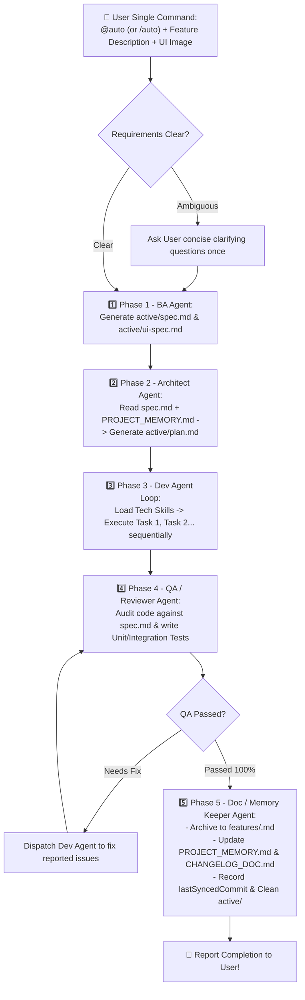

# MASTER BLUEPRINT: AI Agent Skill & Multi-Agent NPM Framework

> This document serves as the architectural blueprint and live progress tracker for the **Multi-Agent & Pluggable Tech Skill CLI Framework**, detailing the core philosophy, 5-Agent + Orchestrator workflow, 3-Tier Markdown Context Lifecycle, interactive CLI wizard, Git Commit Checkpoint Sync, and implementation status.

---

## I. CORE PHILOSOPHY & OBJECTIVES

1. **Eliminating "Context Rot" in Large Projects:**
   - **Context Isolation:** Divide software engineering responsibilities across **5 specialized Agents** (plus **1 Master Orchestrator**), ensuring each Agent only loads the context strictly required for its role.
   - **Markdown-Driven Handoffs:** Agents communicate through structured `.md` artifacts stored in `.ai-workspace/`.
   - **Single Dev Agent + Pluggable Tech Skills:** A single Dev Agent executes atomic tasks sequentially (e.g., Backend -> State/Logic -> Frontend/Mobile) while dynamically loading project-specific **Tech Skills** (`nextjs`, `react-native`, `flutter`, etc.) to prevent race conditions, merge conflicts, and token bloat.
2. **Dual Execution Modes:**
   - **Full Auto-Pilot Mode (`@auto` / `/auto`):** Type a single command with your feature requirement (and optional UI screenshot). The **Master Orchestrator** automatically drives the entire pipeline from A to Z (BA -> Architect -> Dev Task Loop -> QA -> Doc Keeper).
   - **Granular Step-by-Step Mode (`@ba`, `@arch`, `@dev`, `@qa`, `@doc`):** Invoke individual agents manually whenever fine-grained control is desired.
3. **Cross-Platform Compatibility:**
   - Single canonical source in `.agents/` with automatic adapters generated for **Cursor IDE** (`.cursor/rules/*.mdc`), **Claude Code CLI** (`.claude/agents/*.md`, `.claude/commands/*.md`, `CLAUDE.md`), **Google Antigravity** (`.agents/workflows/`, `.agents/skills/`), and **OpenAI Codex** (`AGENTS.md`).
4. **NPM CLI Distribution:**
   - Initialize the full multi-agent system in any project (`init`), install modular tech skills (`add-skill`), run fast-track bugfixes (`hotfix`), and synchronize manual Git commits (`sync`).

---

## II. THE 5 CORE AGENTS + MASTER ORCHESTRATOR

| # | Agent / Trigger | Primary Responsibility | Fixed Core Skills | Input -> Output Artifacts |
| :--- | :--- | :--- | :--- | :--- |
| **0** | **Master Orchestrator (`@auto` / `/auto`)** | **End-to-End Conductor:** Receives user requirements and automatically orchestrates Phase 1 (BA) -> Phase 2 (Architect) -> Phase 3 (Dev task loop) -> Phase 4 (QA review & auto-fix) -> Phase 5 (Doc & workspace cleanup). | • `workflow-orchestrator`<br>• `subagent-dispatcher`<br>• `stage-gate-validator` | Coordinates the entire pipeline from requirement intake to `PROJECT_MEMORY.md` update. |
| **1** | **BA / Product Agent (`@ba` / `/ba`)** | Analyzes business requirements & UI images, asks clarifying questions if ambiguous, identifies edge cases, and writes functional & UI specifications. | • `requirement-clarifier`<br>• `prd-spec-writer`<br>• `ui-vision-to-md`<br>• `bug-triage-spec` | **In:** User Prompt + UI Image + `PROJECT_MEMORY.md`<br>**Out:** `active/spec.md`, `active/ui-spec.md` |
| **2** | **Architect / Tech Lead Agent (`@arch` / `/arch`)** | Initializes project architecture; reads BA specs to design technical solutions, identifies reusable components, and breaks work into sequential atomic tasks. | • `project-onboarding`<br>• `codebase-impact-analyzer`<br>• `system-api-designer`<br>• `atomic-task-planner` | **In:** `active/spec.md`, `ui-spec.md` + `PROJECT_MEMORY.md` + `features/*.md`<br>**Out:** `active/plan.md` |
| **3** | **Dev Agent (`@dev` / `/dev`)** | Executes **one atomic task at a time** from `plan.md`, combining Core Dev Skills with installed **Pluggable Tech Skills**. | **Core:**<br>• `strict-plan-executor` (*Stop & Escalate*)<br>• `clean-code-and-solid`<br>• `safe-refactoring`<br>**Tech Skills (via NPM):**<br>• `nextjs`, `react-native`, `reactjs`, `elysiajs`, `nestjs`, `flutter` | **In:** Single Task in `active/plan.md` + `ui-spec.md` + Tech Skill<br>**Out:** Production-ready Source Code |
| **4** | **QA / Reviewer Agent (`@qa` / `/qa`)** | Independently audits code changes against `spec.md` & `plan.md`, checks for regressions/anti-patterns, and writes Unit/Integration Tests. | • `spec-compliance-checker`<br>• `deep-code-reviewer`<br>• `automated-test-writer` | **In:** `spec.md` + `plan.md` + `git diff` + Tech Skill<br>**Out:** Test Files + `active/review-report.md` |
| **5** | **Doc / Memory Keeper Agent (`@doc` / `/doc`)** | Compacts completed feature context into `features/`, updates the `PROJECT_MEMORY.md` index, logs changes to `CHANGELOG_DOC.md`, updates `lastSyncedCommit`, and cleans `active/`. | • `context-compactor`<br>• `architecture-sync`<br>• `changelog-doc-exporter`<br>• `git-commit-sync` | **In:** `active/*` or `sync-diff.md`<br>**Out:** Updates `features/*.md`, `PROJECT_MEMORY.md`, `CHANGELOG_DOC.md`, `sync-state.json` & clears `active/` |

---

## III. END-TO-END AUTO-ORCHESTRATION FLOW (`@auto` / `/auto`)



---

## IV. UNIFIED SINGLE-FOLDER 3-TIER CONTEXT LIFECYCLE

All generated rules, commands, skills, and 3-tier memory live inside **a single root folder** matching the chosen AI platform (`.cursor/`, `.claude/`, or `.agents/`) so the project root stays 100% clean:

```text
.cursor/ (or .claude/ or .agents/)
├── rules/ (or agents/ or workflows/)  # Native platform Agent rules & file-glob Tech Skills
├── commands/                          # Native Slash Commands (/auto, /ba, /arch, /dev, /qa, /doc...)
└── workspace/                         # 3-Tier Context Memory & Pluggable Tech Skills
    ├── config.json                    # Workspace settings: active platform, installed tech skills.
    ├── PROJECT_MEMORY.md              # [Tier 1 - Global Map] Always kept concise (< 300 lines).
    │                                  # Contains: Tech Stack, Directory Tree, Shared Registry, Feature Index.
    ├── CHANGELOG_DOC.md               # [Documentation Export Layer] Structured release & feature log.
    ├── sync-state.json                # [Git Sync Checkpoint] Stores { "lastSyncedCommit": "<hash>" }.
    ├── skills/                        # Installed Tech Skills (<skill>/SKILL.md)
    ├── active/                        # [Tier 2 - Active Scratchpad] Holds context for ONLY the active feature.
    │   ├── spec.md                    # Upon completion (Phase 5), compacted into features/<feature-name>.md
    │   ├── ui-spec.md                 # and cleared so the next feature starts with a 100% clean slate.
    │   ├── plan.md
    │   └── review-report.md
    └── features/                      # [Tier 3 - Feature Knowledge Vault] Read on-demand per feature.
        ├── auth-login.md              # Top: Current Business Rules & Files. Bottom: Feature Change History.
        └── ...
```

---

## V. INTERACTIVE INITIALIZATION WIZARD (`npx ai-team init`)

1. **Step 1 — Select AI Platform (Single-select):**
   - Options: `Cursor` | `Claude Code` | `Google Antigravity` | `OpenAI Codex`
   - Generates `.agents/` core files and the selected platform adapter (`.cursor/rules/`, `.claude/agents/` + `.claude/commands/`, `CLAUDE.md`, `AGENTS.md`).
2. **Step 2 — Select Project Status:**
   - **Branch 2.1 — Existing Project (Brownfield):** Automatically runs the zero-token project scanner to produce `.ai-workspace/scan-report.md`, then instructs the user to run `@onboard` (or `/onboard`) so the **Architect Agent** populates `PROJECT_MEMORY.md`.
   - **Branch 2.2 — New Project (Greenfield):** Presents 5 project categories to pre-populate baseline directory structures in `PROJECT_MEMORY.md`:
     - `FE`: `Next.js` | `React.js` | `None`
     - `BE`: `Next.js` / `NestJS` | `ElysiaJS` | `None`
     - `Mobile`: `React Native` | `Flutter` | `None`
     - `Fullstack`: Select `FE` + Select `BE`
     - `None`: Leave directory structure blank for custom definition.
3. **Step 3 — Select Tech Skills for Dev Agent (Multi-select: `Space` to toggle, `Enter` to finish):**
   - Pre-selects skills matching Step 2 choices and allows toggling additional skills (`nextjs`, `react-native`, `reactjs`, `elysiajs`, `nestjs`, `flutter`).
   - Records initial Git `HEAD` commit hash into `workspace/sync-state.json`.
4. **Step 4 — Push to Git or Add to `.gitignore` (`Yes` / `No`):**
   - **`Yes`:** Keeps the generated platform folder tracked normally in Git for team collaboration.
   - **`No`:** Automatically appends the generated platform folder (`.cursor/`, `.claude/` + `CLAUDE.md`, or `.agents/` + `AGENTS.md`) to `.gitignore` so the developer can use the AI system locally without polluting a shared repository.

---

## VI. DAILY INTERACTION & CLI COMMANDS

| Scenario | Cursor IDE Chat | Claude Code / Antigravity Chat | Terminal CLI Command |
| :--- | :--- | :--- | :--- |
| **1. Build Feature (Full Auto A -> Z)** | `@auto Build feature X... [attach UI]` | `/auto Build feature X...` | — |
| **2. Step-by-Step Agent Control** | `@ba` -> `@arch` -> `@dev` -> `@qa` -> `@doc` | `/ba` -> `/arch` -> `/dev` -> `/qa` -> `/doc` | — |
| **3. Fast-Track Small Bugfix** | Select lines (`Ctrl+L`) + `@hotfix Fix...` | `/hotfix @file line X: Fix...` | `npx ai-team hotfix "Fix..."` |
| **4. Sync Manual Code Commits** | `@sync` | `/sync` | `npx ai-team sync` |
| **5. Onboard Existing Codebase** | `@onboard` | `/onboard` | `npx ai-team scan` |
| **6. Add / Manage Tech Skills** | — | — | `npx ai-team add-skill` |
| **7. Update Agents & Skills** | — | — | `npx ai-team update` |

---

## VII. EDGE CASES HANDLED BY THE SYNC & SCAN SCRIPTS

1. **Uncommitted Working Tree Changes during `sync`:**
   - Checks `git status --porcelain`. Prompts the user whether to *(1) Include uncommitted working tree changes in the sync report*, *(2) Sync committed changes only*, or *(3) Abort and `git commit` first*.
2. **Missing `lastSyncedCommit` due to `git rebase` / `reset` / `amend`:**
   - Verifies commit existence via `git cat-file -t`. If missing, prompts the user to fallback to the last `1`, `3`, `5`, or `10` commits (`HEAD~N..HEAD`).
3. **Team Collaboration (`git pull`):**
   - Because `sync-state.json` tracks `lastSyncedCommit`, pulling teammates' commits and running `npx ai-team sync` automatically updates the local AI memory with teammates' architectural changes.

---

## VIII. CLI SOURCE CODE ARCHITECTURE & MODULARITY RULES (`src/`)

> **Architectural Rule for AI Assistants & Contributors:**
> Never bundle multiple Tech Skills or Project Structure templates into a single monolithic file. Each skill and each project structure must live in its own dedicated file inside `src/templates/skills/` and `src/templates/project-structures/` respectively, and be re-exported via `index.ts`.

```text
src/
├── index.ts                          # CLI Entrypoint (Commander.js definitions)
├── types.ts                          # Shared TypeScript interfaces & union types
├── commands/                         # CLI command handlers
│   ├── init.ts                       # 3-Step interactive initialization wizard
│   ├── add-skill.ts                  # Add/remove Pluggable Tech Skills
│   ├── sync.ts                       # Git Commit Checkpoint Sync (lastSyncedCommit..HEAD)
│   ├── scan.ts                       # Zero-token codebase tree & dependency scanner
│   ├── hotfix.ts                     # Fast-Track bugfix workflow generator
│   └── update.ts                     # Refreshes agents, workflows, and installed skills
├── templates/                        # Modular Markdown & Prompt templates
│   ├── agents.ts                     # 5 Core Agents + Master Orchestrator (@auto) + 3 Utility Workflows
│   ├── skills/                       # Individual Pluggable Tech Skill definitions (1 file per skill)
│   │   ├── index.ts                  # Barrel registry: TECH_SKILLS_REGISTRY & AVAILABLE_TECH_SKILLS
│   │   ├── nextjs.ts                 # Next.js (App Router) skill
│   │   ├── react-native.ts           # React Native & Expo skill
│   │   ├── reactjs.ts                # React.js SPA skill
│   │   ├── elysiajs.ts               # ElysiaJS & Bun skill
│   │   ├── nestjs.ts                 # NestJS skill
│   │   └── flutter.ts                # Flutter & Dart skill
│   └── project-structures/           # Individual project folder tree templates (1 file per stack)
│       ├── index.ts                  # Barrel registry: STRUCTURE_TEMPLATES & memory/changelog generators
│       ├── nextjs.ts                 # Next.js directory tree
│       ├── reactjs.ts                # React.js directory tree
│       ├── nestjs.ts                 # NestJS directory tree
│       ├── elysiajs.ts               # ElysiaJS directory tree
│       ├── react-native.ts           # React Native directory tree
│       ├── flutter.ts                # Flutter directory tree
│       └── none.ts                   # Blank/custom fallback directory tree
└── utils/                            # Core utilities
    ├── workspace-paths.ts            # Unified single-folder path resolver (.cursor/workspace, .claude/workspace, .agents/workspace)
    ├── platform-adapter.ts           # Generates rules, commands, agents, and skills inside the selected platform folder
    ├── tree-scanner.ts               # Directory & package.json/pubspec.yaml scanner
    └── git.ts                        # Git commit inspection, diff generation, and sync-state helpers
```

### How to Add a New Tech Skill or Stack in the Future:
1. **Register the ID:** Add the new skill key to `TechSkillId` in `src/types.ts`.
2. **Create Skill File:** Create `src/templates/skills/<new-skill>.ts` exporting `<newSkill>Skill: TechSkillDefinition`, then register it in `src/templates/skills/index.ts`.
3. **Create Project Structure File (Optional):** Create `src/templates/project-structures/<new-stack>.ts` and register it in `src/templates/project-structures/index.ts`.

---

## IX. IMPLEMENTATION PROGRESS & HANDOFF LOG (FOR CONTINUATION)

> **Instructions for AI Assistant on Another Device:**
> When the developer pulls this repo on another machine and asks to continue, read this section first to understand what is already built and what can be expanded next.

### ✅ Completed Milestones (v1.0.x - 2026-10-19)
- [x] **System Architecture & Blueprint:** Finalized 5 Core Agents (`BA`, `Architect`, `Dev`, `QA`, `Doc Keeper`) + `Master Orchestrator` (`@auto` / `/auto`) + 3 Utility Workflows (`@hotfix`, `@sync`, `@onboard`).
- [x] **TypeScript CLI Package Scaffolding (`package.json`, `tsconfig.json`, `src/index.ts`):** Built with `commander`, `@clack/prompts`, `fs-extra`, and `picocolors`.
- [x] **Interactive 4-Step `init` Wizard (`src/commands/init.ts`):**
  - Step 1: Single-select AI platform (`cursor`, `claude`, `antigravity`, `codex`) with concise hints that prevent terminal line-wrapping.
  - Step 2: Existing project (auto-scan) vs. New project (`FE`, `BE`, `Mobile`, `Fullstack`, `None` with sub-options).
  - Step 3: Multi-select (`Space` to toggle, `Enter` to confirm) for Tech Skills.
  - Step 4: Platform-agnostic Git tracking choice (`Yes — Track in Git` vs. `No — Add to .gitignore`).
- [x] **Unified Single-Folder Output Architecture (`src/utils/workspace-paths.ts` & `src/utils/platform-adapter.ts`):**
  - Consolidated all generated files into **1 single root directory** per chosen platform (`.cursor/`, `.claude/`, or `.agents/`), placing the 3-tier memory (`PROJECT_MEMORY.md`, `active/`, `features/`, `skills/`) inside `<platform-dir>/workspace/`.
  - Added both `.cursor/rules/*.mdc` (`@auto`, `@ba`...) and `.cursor/commands/*.md` (`/auto`, `/ba`...) for Cursor IDE.
  - Updated Google Antigravity & OpenAI Codex adapter to generate modern `.agents/skills/<slug>/SKILL.md` (providing native `/auto`, `/ba`, `/onboard` slash commands and semantic discovery in Antigravity 2.0).
- [x] **Deep Sub-App & Existing Feature Onboarding (`src/utils/tree-scanner.ts` & `@onboard`):**
  - `scanProjectStructure` automatically detects whether a project is a Single-App or Multi-App/Monorepo (`apps/*`, `packages/*`, `frontend/`, `backend/`, `mobile/`, etc.) and discovers existing features/modules/routes per sub-app.
  - `@onboard` populates `PROJECT_MEMORY.md` (grouping Section 4 Feature Index by Sub-App if multi-app) AND generates individual feature vault files in `workspace/features/<feature-slug>.md` (or `workspace/features/<app-name>/<feature-slug>.md` for multi-app projects) documenting each existing feature's **Current End-to-End Flow**.
  - All downstream agents (`@auto`, `@ba`, `@arch`, `@dev`, `@hotfix`) follow a **2-Step Feature Lookup Protocol**: scan `PROJECT_MEMORY.md` first -> if a requirement matches an existing feature, immediately read its `workspace/features/.../*.md` file and trace its current code flow before planning or modifying code.
- [x] **CLI Operational Commands:**
  - `src/commands/add-skill.ts`: Add/remove Pluggable Tech Skills at any time.
  - `src/commands/sync.ts`: Git Commit Checkpoint Sync (`lastSyncedCommit..HEAD`) with edge-case handling for uncommitted working tree changes and rewritten Git history (`rebase`/`amend`).
  - `src/commands/scan.ts` & `src/utils/tree-scanner.ts`: Zero-token project, sub-app & feature scanner generating `<platform-dir>/workspace/scan-report.md`.
  - `src/commands/hotfix.ts`: Fast-Track bugfix workflow generator.
  - `src/commands/update.ts`: Refreshes agent templates and adapters.
- [x] **English Standardization:** All documentation (`README.md`, `PROJECT_VISION.md`) and all generated Markdown templates (`src/templates/*`) have been converted to professional English.
- [x] **Modular Template Refactoring (`src/templates/skills/` & `src/templates/project-structures/`):** Split monolithic `tech-skills.ts` and `project-structures.ts` into dedicated per-technology files with barrel `index.ts` exports to prevent bloated files and simplify future maintenance.
- [x] **NPM Package Naming (`penta-agent-x`) & GitHub Actions Auto-Publish CI/CD (`.github/workflows/publish-npm.yml`):** Finalized package name as `penta-agent-x` (with CLI binaries `penta-agent-x`, `penta-agent`, `penta`, `ai-team`) and configured automated build, auto-patch version bump, and NPM publish on push/merge to `main` / `master`.

### 🔜 Upcoming Roadmap / Next Steps (To Continue at Home)
1. **Deepen Tech Skill Templates (`src/templates/skills/*.ts`):**
   - Expand each individual file (`nextjs.ts`, `react-native.ts`, `flutter.ts`, `elysiajs.ts`, `nestjs.ts`, `reactjs.ts`) with even deeper project-specific conventions, code snippets, and library-specific rules (e.g., TanStack Query, Zustand, Prisma, Drizzle, Tailwind/NativeWind).
   - Add more modular skills as needed (e.g., `golang.ts`, `python-fastapi.ts`, `graphql.ts`, `supabase.ts`, `turborepo.ts`).
2. **End-to-End Dogfooding Test:**
   - Run `npx penta-agent-x@latest init`, `penta sync`, and `@auto` on a real sample Next.js or React Native project.
3. **Optional Doc Export Command (`npx penta-agent-x export-doc`):**
   - Add a CLI command that combines `workspace/CHANGELOG_DOC.md` and `workspace/features/*.md` into a single formatted `SYSTEM_DOCUMENTATION.md` (or HTML/PDF) for instant client/manager handover.
